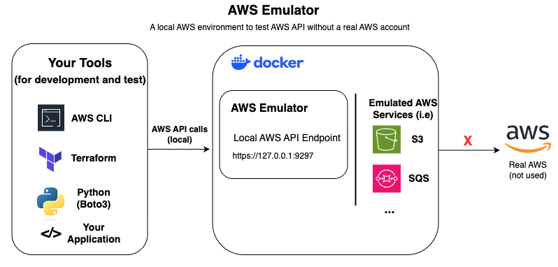

## AWS Emulator - Local Setup and S3 Test

### Overview

AWS Emulator allows us to test AWS APIs locally without using a real AWS account.

In this guide, we run AWS Emulator on macOS using Docker and test S3 operations with AWS CLI.

### Architecture



### Prerequisites

- macOS (Apple Silicon – ARM64)
- Docker Desktop
- AWS CLI v2

### 1. Create Dockerfile

Create a project directory:

```
mkdir -p aws-emulator
cd aws-emulator
```

Create a `Dockerfile`: [Dockerfile](./Dockerfile)

### 2. Build Docker Image

```
docker build -t aws-emulator .
```

### 3. Start AWS Emulator

Create a local configuration directory:

```
mkdir -p ~/.aws/emulator
```

Start the emulator:

```
docker run --rm \
  --memory=2g \
  --memory-swap=2g \
  -p 127.0.0.1:9297:9297 \
  -e HOME=/home/emulator \
  -v "$HOME/.aws/emulator:/home/emulator/.aws/emulator" \
  aws-emulator -p 9297 --telemetry off
```

The emulator runs at:

```
https://127.0.0.1:9297
```

Keep this terminal open while using the emulator.

### 4. Configure AWS CLI

Open a new terminal and configure the environment variables:

```
export AWS_ENDPOINT_URL=https://127.0.0.1:9297

export AWS_SHARED_CREDENTIALS_FILE="$HOME/.aws/emulator/9297/emulator_credentials"

export AWS_CONFIG_FILE="$HOME/.aws/emulator/9297/config"

export AWS_CA_BUNDLE="$HOME/.aws/emulator/9297/ca.pem"

export AWS_EC2_METADATA_DISABLED=true
export AWS_DISABLE_HOST_PREFIX_INJECTION=true

export AWS_REGION=eu-central-1
export AWS_DEFAULT_REGION=eu-central-1

unset AWS_ACCESS_KEY_ID
unset AWS_SECRET_ACCESS_KEY
unset AWS_SESSION_TOKEN
unset AWS_PROFILE
```

### 5. Test AWS Connection

Run:

```
aws sts get-caller-identity
```

Expected output:

```json
{
  "UserId": "AIDAH5I7GEMO7ADXNFAZU",
  "Account": "000000000000",
  "Arn": "arn:aws:iam::000000000000:user/emulator"
}
```

The account ID `000000000000` indicates that the CLI is connected to the emulator.

### 6. Create an S3 Bucket

Create a bucket:

```
aws s3api create-bucket \
  --bucket test-local-bucket
```

List buckets:

```
aws s3api list-buckets
```

Expected bucket:

```
test-local-bucket
```

### 7. Upload a File to S3

Create a JSON file:

```
echo '{"environment":"local","service":"aws-emulator"}' > test.json
```

Upload it:

```
aws s3 cp test.json s3://test-local-bucket/
```

List bucket contents:

```
aws s3 ls s3://test-local-bucket/
```

### 8. Download and Verify the File

Download the file:

```
aws s3 cp \
  s3://test-local-bucket/test.json \
  downloaded.json
```

Compare the original and downloaded files:

```
diff test.json downloaded.json
```

An empty output means both files are identical.

### 9. Test Terraform Integration

Terraform can also be used to create AWS resources locally through AWS Emulator.

**Prerequisite:** Install [Terraform](https://developer.hashicorp.com/terraform/install).

9.1. Create a project directory:
```
mkdir -p terraform-aws-emulator
cd terraform-aws-emulator
```

9.2. Create a [main.tf](./main.tf) file.


9.3. Initialize Terraform:

```
terraform init
```

9.4. Preview the changes:

```
terraform plan
```

9.5. Create the S3 bucket:

```
terraform apply
```

Type `yes` when prompted.

Expected output:

```
Apply complete! Resources: 1 added, 0 changed, 0 destroyed.
```

9.6. Verify the bucket using AWS CLI:

```
aws s3api list-buckets
```

9.7. Expected buckets:

```
test-local-bucket
terraform-local-test-bucket
```

9.8. Delete the Terraform-managed bucket:

```
terraform destroy
```

Type `yes` when prompted.

Expected output:

```
Destroy complete! Resources: 1 destroyed.
```

### 10. Stop AWS Emulator

Go to the terminal running Docker and press:

```
Ctrl + C
```


### Limitations

- AWS Emulator does not support all AWS services and API operations yet.
- Unsupported operations return `501 Not Implemented`.
- Resource state is stored in memory and is lost when the emulator stops.
- Each emulator instance has its own isolated resources and credentials.
- It is designed for local development and testing, not production workloads.
- Always check the [AWS Emulator Fidelity Report](https://docs.aws.amazon.com/emulator/latest/userguide/fidelity.html) before using a specific AWS service.


### References
- [AWS Emulator Announcement - AWS What's New (November 11, 2026)](https://aws.amazon.com/about-aws/whats-new/2026/11/aws-emulator-now-available/)
- [AWS Emulator Documentation](https://docs.aws.amazon.com/emulator/latest/userguide/)
- [AWS Emulator GitHub Repository](https://github.com/aws/aws-emulator)